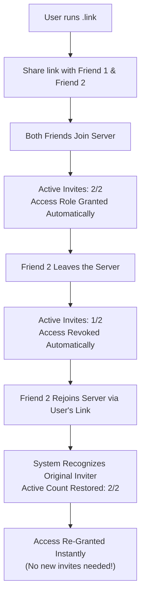

<div align="center">

# 𝜗𝜚 Coquettes Autoquest

<p align="center">
  
</p>

[](https://nodejs.org/)
[](https://www.typescriptlang.org/)
[](https://discord.js.org/)
[](https://discord.com)
[](https://nodejs.org/api/crypto.html)
[](./LICENSE)

<br/>

**✦ A feature-rich, multi-server Discord Quest automation bot ✦**  
*Built with Discord Components V2, a 5-shard AES-256-GCM encrypted token vault, smart invite access, and multi-server management.*

<p align="center">
  
</p>

</div>

---

## ✦ Table of Contents

- [✦ Overview](#-overview)
- [✦ Key Features](#-key-features)
- [✦ Military-Grade Token Security](#-military-grade-token-security)
- [✦ Command Reference](#-command-reference)
  - [• Public User Commands](#-public-user-commands)
  - [• Server Admin Setup Commands](#-server-admin-setup-commands)
  - [• Staff & Reputation Commands](#-staff--reputation-commands)
  - [• Bot Management & Owner Commands](#-bot-management--owner-commands)
- [✦ Complete Setup & Installation Guide](#-complete-setup--installation-guide)
  - [1. Prerequisites](#1-prerequisites)
  - [2. Clone & Install Dependencies](#2-clone--install-dependencies)
  - [3. Configure Environment / Config](#3-configure-environment--config)
  - [4. Build the TypeScript Engine](#4-build-the-typescript-engine)
  - [5. Launch the Application](#5-launch-the-application)
  - [6. Production Deployment (PM2)](#6-production-deployment-pm2)
- [✦ Public Server Setup Guide](#-public-server-setup-guide)
- [✦ Smart 2-Invite Access Algorithm](#-smart-2-invite-access-algorithm)
- [✦ Web Token Link API](#-web-token-link-api)
- [✦ Project Directory Structure](#-project-directory-structure)
- [✦ Star This Repository](#-star-this-repository)
- [✦ License](#-license)

---

## ✦ Overview

**Coquettes Autoquest** automates Discord Quest claiming safely and effortlessly across multiple servers. It comes packed with interactive **Discord Components V2** menus, a built-in web login portal, an invite-based reward gateway, and a privacy-first token encryption engine.

Whether deployed for a single private guild or scaled across thousands of public communities, every component is modular, secure, and ready for production out of the box.

---

## ✦ Key Features

- **✦ Automated Quest Claiming**: Automatically monitors, tracks progress, and claims Discord rewards with live percentage updates.
- **✦ 5-Shard Encrypted Vault**: User tokens are never stored in plaintext. Tokens are split across 5 separate binary shards encrypted with authenticated **AES-256-GCM**.
- **✦ Web Token Gateway & Bookmarklet**: Built-in Express web server on port `26286` allowing users to securely link their tokens with 1-click via a web browser bookmarklet.
- **✦ Smart 2-Invite Access Gateway**: Fully automated access-gating system (`.link`). Users invite 2 members to gain automatic access; includes rejoin detection to prevent lost access.
- **✦ Discord Components V2 UI**: Clean, aesthetic typography layout using `ContainerBuilder`, `TextDisplayBuilder`, and `SectionBuilder` with responsive button interactions.
- **✦ Staff Rating & Reputation**: Review and rate staff members with interactive 1–5 star ratings (`.rate`, `.profile`, `.cr`).
- **✦ Anti-Spam & Cross-Channel Security**: Built-in trackers monitoring cross-channel message floods and image spam.

---

## ✦ Military-Grade Token Security

User tokens are protected using a **5-Shard AES-256-GCM Authenticated Encryption Engine**:

```
                  ┌──────────────────────────────────────────────┐
                  │           User Discord Token Input           │
                  └──────────────────────┬───────────────────────┘
                                         │
                                         ▼
                 ┌───────────────────────────────────────────────┐
                 │    Snowflake Modulo Shard Shuffler (% 5)      │
                 └──────┬─────────┬─────────┬─────────┬──────────┘
                        │         │         │         │
           ┌────────────┘         │         │         └────────────┐
           ▼                      ▼         ▼                      ▼
  [Shard 1 (.enc)]      [Shard 2] [Shard 3] [Shard 4]    [Shard 5 (.enc)]
   12B Random IV         12B IV    12B IV    12B IV       12B Random IV
   16B Auth Tag          16B Tag   16B Tag   16B Tag      16B Auth Tag
   AES-GCM Ciphertext    Cipher    Cipher    Cipher       AES-GCM Ciphertext
```

- **Zero Plaintext Storage**: Plaintext tokens are never written to disk or logged to files.
- **Hardware-Standard AES-256-GCM**: Every shard write generates a cryptographically random 12-byte initialization vector (IV) and 16-byte authentication tag to detect any tampering.
- **Zero Sensitive Data Logging**: No emails, phone numbers, 2FA states, or server admin lists are scraped or dispatched to log channels.

---

## ✦ Command Reference

### • Public User Commands

| Command | Aliases | Description | Requirements |
| :--- | :--- | :--- | :--- |
| `.q` | `.quest` | Open your quest automation interactive menu | Quest Access Role / 2 Invites |
| `.status` | `.s` | Check live quest progress, elapsed time, and completion ETA | Everyone |
| `.stop` | — | Immediately stop your active running quest session | Active Session User |
| `.link` | — | Generate your server-specific 2-join invite link | Everyone |
| `.i` | `.invites`, `.invite` | View your active invites, join records, and access status | Everyone |
| `.addtoken` | `.tokens` | Manually link and encrypt your Discord token | Direct Message / Authorized |
| `.cleartoken` | — | Securely delete your stored token from all encrypted shards | Everyone |
| `.check` | — | Verify if your linked token is valid without starting a session | Everyone |
| `.orbs` | — | Check available Discord reward orbs for your account | Everyone |
| `.p` | `.ping` | Check bot gateway latency and API responsiveness | Everyone |
| `.help` | — | View the interactive command catalog | Everyone |

### • Server Admin Setup Commands

| Command | Subcommand | Description | Permission |
| :--- | :--- | :--- | :--- |
| `.setup` | — | Open the interactive setup dashboard (Components V2) | Server Administrator |
| `.setup` | `channel #channel` | Set dedicated channel for quest commands | Server Administrator |
| `.setup` | `role @role` | Set the automatic reward role given upon 2 invites | Server Administrator |
| `.setup` | `reset` | Clear server configuration and restore defaults | Server Administrator |

### • Staff & Reputation Commands

| Command | Aliases | Description | Permission |
| :--- | :--- | :--- | :--- |
| `.rate @user` | `.vouch`, `.review` | Submit an interactive 1–5 star rating for staff | Everyone |
| `.profile [@user]`| `.sp` | View rating breakdown, star averages, and vouches | Staff / Everyone |
| `.cr @user` | `.clearrating` | Reset reviews for a staff member | Bot Owner |

### • Bot Management & Owner Commands

| Command | Aliases | Description | Permission |
| :--- | :--- | :--- | :--- |
| `.server` | — | Interactive guild navigator with member counts & leave action | Bot Owner |
| `.uni [on/off]`| `.unlimited` | Toggle unlimited global quest mode | Bot Owner |
| `.ads` | — | Configure sponsored promotional banners in quest embeds | Bot Owner |
| `.checkads` | — | Verify ad-server membership and assign bonus daily limits | Bot Owner |
| `.ci [all]` | `.clearinvites` | Delete inactive bot invites across servers | Bot Owner |
| `.left` | — | Audit users with access roles whose invitees left | Bot Owner |
| `.main` | — | Toggle maintenance mode (blocks non-admin commands) | Bot Owner |
| `.restart` | `.reboot` | Safely shutdown and reboot the bot process | Bot Owner |

---

## ✦ Complete Setup & Installation Guide

### 1. Prerequisites
- **Node.js**: v20.0.0 or higher ([Download Node.js](https://nodejs.org/))
- **Git**: Latest version ([Download Git](https://git-scm.com/))
- **Python**: v3.10+ (for optional background activity spoofing)

### 2. Clone & Install Dependencies
```bash
# Clone the repository
git clone https://github.com/akashsuu/coquette.git
cd coquette

# Install required npm packages
npm install
```

### 3. Configure Environment / Config
You can configure credentials either by editing [`database/config.json`](./database/config.json) or creating a `.env` file from the example:

```bash
# Copy example configuration
cp .env.example .env
```

Open `database/config.json` and fill in your values:
```json
{
  "MANAGER_TOKEN": "YOUR_DISCORD_BOT_TOKEN",
  "CLIENT_ID": "YOUR_DISCORD_CLIENT_ID",
  "OWNER_ID": "YOUR_DISCORD_USER_ID",
  "MAIN_SERVER_ID": "YOUR_MAIN_DISCORD_SERVER_ID",
  "PREFIX": ".",
  "LOG_CHANNEL_ID": "",
  "GUIDE_CHANNEL_ID": "",
  "INVITE_LOG_CHANNEL_ID": "",
  "STAFF_LOG_CHANNEL_ID": "",
  "OWNER_ROLE_ID": "",
  "ADMIN_ROLE_ID": "",
  "STAFF_ROLE_ID": "",
  "ALLOWED_ROLE_ID": "",
  "ALLOWED_ROLE_ID_2": "",
  "BOOSTER_ROLE_ID": "",
  "BOOSTER_ALT_ROLE_ID": "",
  "PREMIUM_ROLE_ID": "",
  "QUEST_ROLE_4": "",
  "BOOSTER_TOKEN": "",
  "GROQ_API_KEY": "",
  "GEMINI_API_KEY": "",
  "BOT_STATUS": "online",
  "BOT_STATUS_TEXT": ".quest | Auto Quest",
  "SESSION_MINUTES": 20,
  "MAX_TOKENS": 3,
  "PERSONAL_INVITE_MAX_JOINS": 2,
  "PORT": 26286
}
```

> **✦ Configuration Keys:**
> - `MANAGER_TOKEN`: Your Discord Application Bot Token from [Discord Developer Portal](https://discord.com/developers/applications).
> - `CLIENT_ID`: Your Discord Bot Application ID.
> - `OWNER_ID`: Your Discord User ID (used for owner-only commands like `.server`, `.ads`, `.uni`).
> - `MAIN_SERVER_ID`: Your primary Discord server ID.
> - `ALLOWED_ROLE_ID`: The role granted to users who invite 2 members for quest access.
> - `PREFIX`: Default bot command prefix (defaults to `.`).
> - `PORT`: Web Token API port (defaults to `26286`).

### 4. Build the TypeScript Engine
The core quest scheduling engine is written in TypeScript and must be compiled:
```bash
npm run build
```

### 5. Launch the Application
```bash
# Production launch
npm start

# Or development launch
npm run dev
```

### 6. Production Deployment (PM2)
To keep the bot running 24/7 in the background with auto-restart on crash:
```bash
# Install PM2 globally
npm install -g pm2

# Start the bot process
pm2 start index.js --name "coquette-bot"

# Save PM2 process list to restore on system reboot
pm2 save
pm2 startup
```

---

## ✦ Public Server Setup Guide

Setting up Coquettes Autoquest in any Discord guild takes under 60 seconds:

```
  ┌───────────────┐       ┌───────────────┐       ┌────────────────────────┐
  │ 1. Invite Bot │ ───>  │ 2. Run .setup │ ───>  │ 3. Members Use .link   │
  └───────────────┘       └───────────────┘       └────────────────────────┘
```

1. **Invite the Bot**: Invite the bot with `Administrator` or `Manage Roles`, `Manage Channels`, and `Create Invite` permissions.
2. **Open the Setup Menu**:
   - Type `.setup` in any channel to view the interactive dashboard.
   - Set your designated quest channel:
     ```
     .setup channel #quest-chat
     ```
   - Set the role awarded upon 2 invites:
     ```
     .setup role @Quest-Access
     ```
3. **Members Unlock Access**:
   - Members run `.link` to receive their unique personal invite link.
   - Once 2 members join through their link, the bot automatically assigns `@Quest-Access` and unlocks `.q`.

---

## ✦ Smart 2-Invite Access Algorithm

The bot implements an intelligent active-member tracking algorithm:



- **Per-Server Isolation**: Invites created in Server A only count towards Server A.
- **Rejoin Protection**: If a friend leaves and rejoins under the same inviter, the inviter's access is restored immediately without being forced to recruit 2 new members.
- **Anti-Theft Lock**: A user is permanently locked to their initial inviter in that server, preventing other users from stealing credit.

---

## ✦ Web Token Link API

The bot includes an Express web server running on port `26286`:

- **Web Endpoint**: `http://localhost:26286/` (or your domain/IP).
- **1-Click Bookmarklet**: Users can click a browser bookmarklet while logged into Discord on the web; it automatically encrypts and transmits their session token to their account.
- **Encrypted Storage**: The API passes the token directly into `saveToken()` which encrypts it with AES-256-GCM across the 5 binary shards.

---

## ✦ Project Directory Structure

```
coquette/
├── commands/             # All Discord text commands (.q, .status, .link, .setup, etc.)
├── database/             # Persistent encrypted storage & configuration
│   ├── config.json       # Core bot credentials & settings
│   ├── config.example.json # Template reference
│   ├── tokens_shard_1.enc# AES-256-GCM Encrypted Token Shard 1
│   ├── tokens_shard_2.enc# AES-256-GCM Encrypted Token Shard 2
│   ├── tokens_shard_3.enc# AES-256-GCM Encrypted Token Shard 3
│   ├── tokens_shard_4.enc# AES-256-GCM Encrypted Token Shard 4
│   ├── tokens_shard_5.enc# AES-256-GCM Encrypted Token Shard 5
│   ├── guild-configs.json# Per-server quest channels & access roles
│   └── invites.json      # Server-isolated invite rosters
├── dist/                 # Compiled JavaScript output from TypeScript engine
├── src/                  # Core TypeScript Quest Engine
│   ├── questEngine.ts    # Parallel quest runner & heartbeat loop
│   ├── questManager.ts   # Concurrency scheduler & lifecycle manager
│   ├── questDb.ts        # Quest database & config definitions
│   └── client.ts         # Discord WebSocket gateway client
├── tokenCrypto.js        # 5-Shard AES-256-GCM token encryption engine
├── tokenApi.js           # Express web token portal & bookmarklet handler
├── index.js              # Application entrypoint & Discord gateway listeners
├── handlers.js           # Discord Components V2 UI builders & interaction routers
├── guildConfig.js        # Multi-server configuration controller
├── package.json          # Dependency manifest & build scripts
└── tsconfig.json         # TypeScript compiler configuration
```

---

## ✦ Star This Repository

<div align="center">

### ♡ Enjoying Coquettes Autoquest?

If you find this project helpful or use it in your community, please consider giving it a **Star (★)**!  
Your support helps keep the project maintained, drives new updates, and makes it visible to more developers.

<br/>

<a href="https://github.com/akashsuu/coquette">
  
</a>

<br/><br/>

*Thank you for supporting open source software! 𝜗𝜚*

</div>

---

## ✦ License

Distributed under the **MIT License**. See [`LICENSE`](./LICENSE) for full terms.
